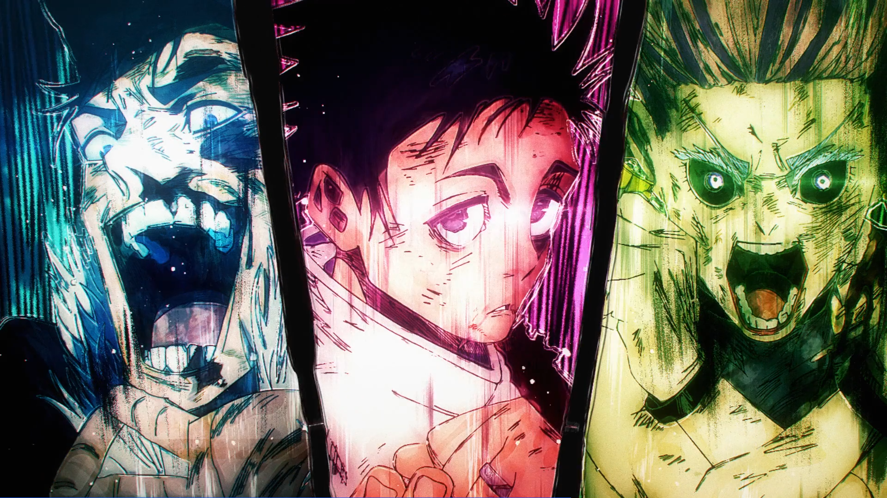

# 图片自由裁剪 · 使用说明

> 本文档对应图形界面的实际行为逐步编写。图文版手册见同目录下的 [图片自由裁剪-使用说明.pdf](图片自由裁剪-使用说明.pdf)。

## 界面总览

```
┌────────────────────────────────────────────────────────────┐
│  导入图片… / 移除源图 / 清空源图 │ 导出图片…      深色模式 ☐ │
├──────────┬──────────────────────────────────┬──────────────┤
│ 源图列表  │  ① 裁剪素材   ② 合成画布（页签）  │ 素材库        │
│          │  ┌────────────────────────────┐  │ （裁剪结果）   │
│ 双击在裁  │  │                            │  │              │
│ 剪区打开  │  │       画布工作区            │  │ 选中元素属性   │
│          │  │  （滚轮缩放/中键平移）        │  │ 位置/缩放/    │
│          │  │                            │  │ 旋转/翻转/    │
│          │  └────────────────────────────┘  │ 图层/边框     │
├──────────┴──────────────────────────────────┴──────────────┤
│ 状态栏：数量统计 · 模式 · 画布 · 撤回步数 · 操作提示          │
└────────────────────────────────────────────────────────────┘
```

- **左侧**：导入的源图列表，单击/双击即在中间「裁剪素材」页打开。
- **中间**：两个页签 —— ① 在源图上裁剪；② 把素材拼排成成品图。
- **右侧**：裁出来的素材库 + 当前选中元素的属性面板。

## 快速上手（三步出图）

1. **导入**：点「导入图片…」选择图片，或直接把图片文件**拖进窗口任意位置**。
   支持 PNG / JPG / BMP / WEBP / GIF / TIFF（动图取第一帧）。
2. **裁剪**：在「① 裁剪素材」里框出想要的部分，点「加入素材库」。重复裁出多张素材。
3. **合成**：切到「② 合成画布」，在素材库点「添加到画布」或「全部加入」，摆好后点「导出图片…」。

---

## ① 裁剪素材

### 三种裁剪方式

| 方式 | 操作 |
|---|---|
| **矩形** | 按住左键拖出选框；框内按住左键可整体移动，四角可拖动调整大小 |
| **多边形** | 依次**点击**添加顶点；**点击起点**或**右键**闭合；<kbd>Backspace</kbd> 撤销上一个顶点，<kbd>Esc</kbd> 清空 |
| **套索** | 按住左键沿想要的轮廓描边，松开自动闭合 |

多边形 / 套索裁出的素材**形状以外区域为透明**，边缘自动抗锯齿，可继续叠加边框。

### 完成/确认裁剪

选区闭合后（多边形出现「已闭合」提示）**再点一下画布**，或直接点「加入素材库」，即生成素材并进入右侧素材库。右键在「已闭合」状态下同样是确认入库。

### 边框

工具栏可选 **无 / 白色 / 黑色**，宽度 0–200 像素：

- 矩形裁剪：向四周外扩一圈纯色边框；
- 多边形 / 套索裁剪：**沿轮廓描边**，形状外保持透明；
- 边框在渲染时实时套用，之后还可在右侧属性面板随时修改（对所有使用该素材的元素生效）。

### 视图操作（裁剪页与合成页通用）

| 操作 | 方式 |
|---|---|
| 缩放 | 滚轮（以鼠标位置为中心）；或 <kbd>＋</kbd><kbd>－</kbd> 按钮 |
| 平移 | 按住**中键**拖拽 |
| 适应窗口 / 1:1 | 工具栏对应按钮 |

---

## ② 合成画布

### 三种合并模式

**自由** —— 素材随意摆放的画板：

- 按住左键拖动元素；单击元素即选中并**置于最上层**；
- 「自动贴紧」开启时，元素靠近其他元素或画布的**边缘 / 中线**会自动吸附，并显示粉色辅助线，方便无缝拼接和对齐；
- 选中元素后可在右侧面板精确调整：位置 X/Y、缩放 %（1–2000）、旋转（90° 步进）、水平 / 垂直翻转、上移 / 下移一层；
- <kbd>Del</kbd> 删除选中元素。

**顺序拼接** —— 素材按素材库顺序首尾相接：

- 方向：横向 / 纵向；间距：0–2000；对齐：起始 / 居中 / 末端（垂直于拼接方向的对齐方式）。

**网格** —— 表格式排版：

- 行 × 列（1–20）、间距、单元尺寸（自动 = 取最大素材尺寸，或自定义宽×高）；
- 填充方式：**适应**（等比缩小放入格子）/ **填充**（等比放大铺满并居中裁掉多余）/ **拉伸**（变形填满）/ **原始**（1:1 放置并居中裁掉超出部分）；
- 素材多于格子数时**自动分页**，导出时输出多张成品图。

### 画布与背景

- 画布宽高（1–20000）仅在**自由模式**下可编辑；「贴合内容」一键把画布收缩到所有元素的外包围盒（四周留 20px 边距）；
- 间隙 / 背景：**透明**或任意纯色（点色块打开取色器）。拼接 / 网格模式下它同时是**格子间隙的颜色**；
- 透明背景在画布上以棋盘格显示，导出 PNG / WEBP 保留透明。

### 导出

点「导出图片…」：

| 选项 | 说明 |
|---|---|
| 输出文件夹 / 文件名前缀 | 默认前缀「合成」 |
| 成品图 | 按当前模式合成；多页时文件名带 `_01` `_02`… |
| 裁剪后的素材 | 每个素材单独一张，文件名带 `素材01` `素材02`… |
| 格式 | PNG（保留透明）/ JPEG（透明区域自动压成白底）/ WEBP |
| 质量 | 1–100，默认 95（PNG 无损，此项不生效） |

---

## 撤回、设置与其他

- **Ctrl+Z**：全局撤回，最多 50 步，素材增删、参数调整、拖动摆放均可回退。
- **拖拽导入**：把图片文件（或多选的一批文件）直接拖进窗口即可导入，不必点按钮。
- **设置记忆**：主题、裁剪方式、边框、合并模式、拼接 / 网格参数、上次导出目录都保存在程序目录下的 `settings.json`——整个文件夹拷到别的电脑，设置依然跟着走（画布尺寸属于文档属性，不记忆）。
- **深色模式**：右上角勾选，立即生效并自动保存。
- **大图保护**：超大素材会自动限制渲染像素上限，避免极端缩放撑爆内存。

---

## 样例演示

样例文件在仓库 [examples/](../examples/) 目录，可直接下载后用本工具练手：

| 文件 | 说明 |
|---|---|
| `1.png` / `2.png` / `3.png` | 三张角色立绘（1152×1792），用来裁素材 |
| `领域展开.png` | 参考样品图（1920×1079）：三条斜切竖幅 + 黑色斜缝的构图 |
| `成品/领域展开风格_成品.png` | 最终合成效果 |

**制作过程：**

1. 导入三张立绘，各用**多边形**裁剪，把人物裁成带斜边的**梯形竖幅**（斜边走向对照样品图）；
2. 「② 合成画布」把**间隙 / 背景设为黑色**；
3. 「自由」模式下把三条竖幅**并排摆放**（开启自动贴紧辅助对齐）——竖幅之间露出的画布，就形成了等宽的黑色斜缝；
4. 导出 PNG。

**对照效果**（上：参考样品图，下：本工具制作的成品）：

**样品图（领域展开.png）——参考构图：三条斜切竖幅 + 黑色斜缝**



**本工具制作的成品——用 1.png / 2.png / 3.png 裁出斜边竖幅后拼接**


**用到的素材原图：**

| 1.png | 2.png | 3.png |
|---|---|---|
|  |  |  |

---

## 常见问题

**剪出来的素材形状外是透明的，怎么保存才不会丢？**

导出时选 PNG 或 WEBP 可保留透明。注意：把透明图直接发到微信 / QQ 会自动变白底（聊天软件会压缩成 JPG），请打包成压缩包发送。

**矩形 / 多边形 / 套索分别什么时候用？**

边缘整齐的截图、照片局部用**矩形**；沿人物轮廓、任意形状用**多边形**；习惯手感描边的用**套索**。同一素材可以反复「添加到画布」使用多次。

**为什么拼接完的图片边缘多了黑线 / 白线？**

多半是「自动贴紧」把素材吸附到了边缘线附近。Ctrl+Z 撤回，关闭「自动贴紧」后重新拖放。

**双击 exe 闪退，或被提示有病毒？**

先把程序放到普通文件夹再运行（不要在压缩包里直接双击）；若 Windows SmartScreen 弹出蓝色提示，点「更多信息 → 仍要运行」；个别杀毒软件误报时把程序加入白名单即可。
